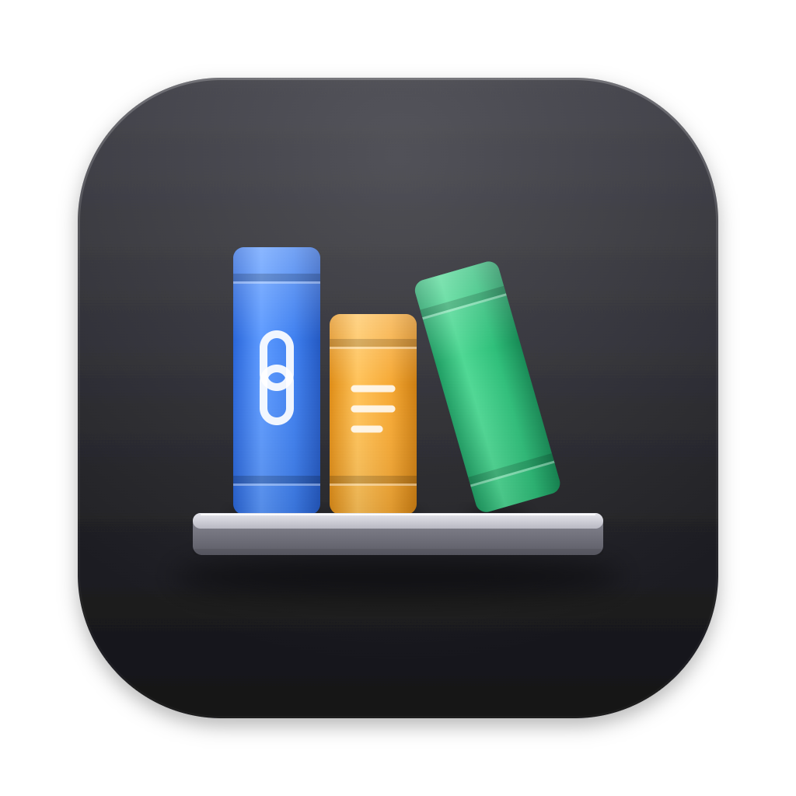

# Linkshelf

**Paste your links into job applications without hunting for them.**

Every application asks for the same things: your LinkedIn, your GitHub, your portfolio, your phone number. Linkshelf keeps them in a small window beside your browser. Click one and it's copied. Press ⌘V and you're done.



## Why it's faster

- **One click to copy.** No new tab, no address bar, no select-all.
- **You stay in the form.** Clicking Linkshelf doesn't pull you out of your browser, so you can paste right away.
- **Or skip the mouse.** Press ⌃⌥1 to copy your first item, ⌃⌥2 for the second, up to ⌃⌥9. This works from any app.
- **It stays in view.** The window floats above your other windows, so it's there when you need it. You can turn this off in settings.

## What you can save

- **Links:** your LinkedIn, GitHub, portfolio, a résumé link
- **Text:** your phone number, email, address, or a short answer you give often

Group them into **modes**, such as "Job hunt" or "Freelance", and switch between them from the title bar.

## Shortcuts

| Press | To |
| --- | --- |
| ⌃⌥1 … ⌃⌥9 | Copy item 1–9, from any app |
| ⌘N | Add an item |
| ⌘↵ | Save the item you're editing |
| ⌘, | Open settings |
| Esc | Close a dialog, or finish reordering |

Each row shows its shortcut on the right.

## Your data stays on your Mac

There's no account and no cloud. Linkshelf doesn't connect to the internet. Everything is saved in one file on your Mac:

```
~/Library/Application Support/Linkshelf/config.json
```

When you run the app from source, the folder is called `linkshelf-menubar-macos` instead.

## Get started

You'll need a Mac and [Node.js](https://nodejs.org) 22.12 or newer.

```bash
npm install
```

```bash
npm start
```

The window opens with a few starter items. Edit or delete them, then add your own with **+**.

## Build the app

```bash
npm run package
```

This creates a `.dmg` installer in the `dist` folder.

## For developers

| Command | What it does |
| --- | --- |
| `npm start` | Runs the app with live reload |
| `npm run build` | Builds the interface into `dist` |
| `npm run build:electron` | Compiles the main process into `electron-dist` |
| `npm run package` | Builds a `.dmg` installer |
| `npm run lint` | Checks the code |
| `npm run icons` | Regenerates the app icons from `electron/assets/logo.svg` |

**Built with** Electron, React, TypeScript, Vite, Tailwind CSS and the [Allo](https://allo.joshpuckett.me) typeface.

**Where things are:**

```
electron/        The app window, shortcuts and storage (main process)
  assets/        Icons and their SVG sources
src/
  components/    The interface: list, rows, dialogs, menus
  hooks/         State for modes and items
  lib/           Small helpers, like item order for shortcuts
  state/         Saving and loading data
  styles/        Colors, fonts and layout
  types/         Data types and the starter items
scripts/         Icon generator
```

## License

MIT
